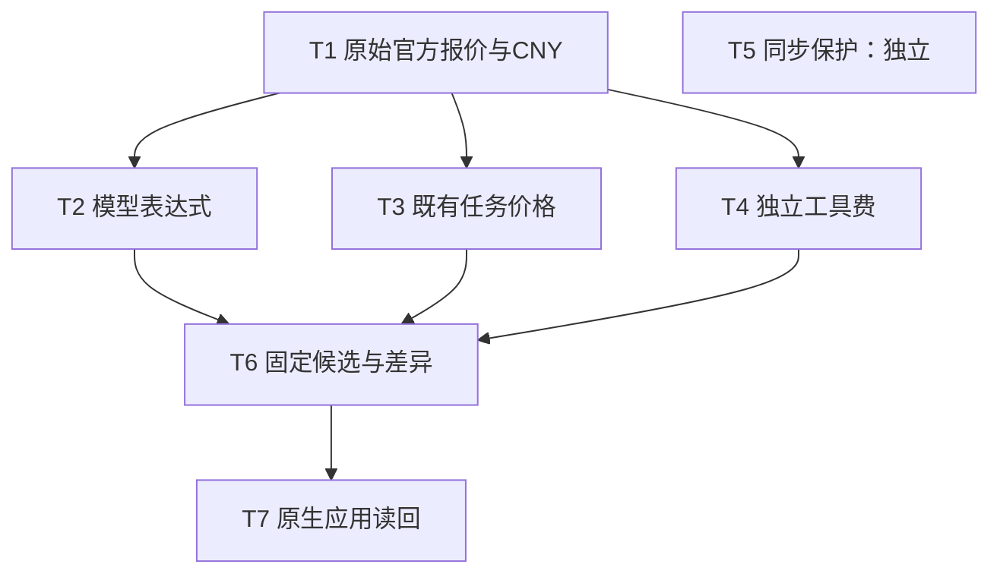

# AC / Ticket / 测试边界追溯

本表是[批准Spec快照](snapshots/spec-v0.12.md) §7的派生索引，不重新定义AC。前三列逐行提取原文，稳定编号保持AC-01—AC-30；附录原AC/旧B、W等位置标签仍在只读快照中。规范性变更由Planner更新唯一来源后再更新此表。

G＝公开生成入口；S＝产物/schema/语义差异及本地同步历史；A＝原生适配器确定性mock；I＝授权隔离官方rc50配置保存/读回。原版离线解析/算费、GitHub手动CI另列实际证据，不能冒称I、真实供应商usage/钱包扣款或O/R。下面是适用位置，不表示每个AC在每一格都实际运行过。

| 稳定AC | 原归属 | 原Spec当前取用/移出说明（原文） | 原票显式AC归属 | 适用已同意seam/边界 |
|---|---|---|---|---|
| AC-01 | D+O | D生成和配置导入读回；O真实调用价格适用性 | T1 / T2 / T7 | G/S/A/I |
| AC-02 | D | CNY保真、拒绝估算USD替代 | T1 | G/S |
| AC-03 | D+O | D官方价目显式选择；O实际渠道/地域映射 | T1 | G/S/I |
| AC-04 | D | 原始USD单次×7及重复构建幂等 | T1 / T2 | G/S/I |
| AC-05 | D+O | D缺字段不发布新价；O存量销售异常政策 | T1 / T4 | G/S/A |
| AC-06 | D | 真实语义diff与噪声排除 | T6 | S |
| AC-07 | D+O | D保留来源核对日期；O核价频率与执行 | T6 | G/S |
| AC-08 | D+O | D金额/TTL/阈值表达完整；O真实usage/收费一致性 | T2 / T3 | G/S/I |
| AC-09 | D+O | D固定算例与单位；O真实消费/账单集成 | T2 | G/S；原版离线算例单列 |
| AC-10 | D+O | D以0.8为原生集成输入且不重复倍率；O实际组配置 | T7 | A/I；倍率输入/保留 |
| AC-11 | D | 固定产物、原生应用与读回/部分失败 | T7 | S/A/I |
| AC-12 | O | 历史消费不重算为原生/业务账单集成；本专项不开发账单 | — | O，不新增D seam |
| AC-13 | D+O | D目标单位配置预检/读回；O余额充值分配全链路 | T7 | A/I |
| AC-14 | O | 运营实际分组倍率A＜B＜C；不开发倍率后台 | — | O，不新增D seam |
| AC-15 | D+O | D已有工具价原币种/单位/配置包；O工具次数和真实收费 | T4 / T7 | G/S/A/I |
| AC-16 | D+O | D明确确认输入/目标与冲突记录；O生产身份、人员与启用批准 | T6 / T7 | S/A/I |
| AC-17 | D | 上游同步保护与合并失败隔离；可用本地历史夹具 | T5 | S，本地Git历史 |
| AC-18 | D | 覆盖顺序、完整cost、独立收费字段检查 | T1 / T2 / T3 / T4 | G/S/I |
| AC-19 | D+O | Dworkflow声明/输出隔离设计及fixture；O真实仓库权限与运行启用 | T5 | S；托管状态另列 |
| AC-20 | D+O | D显式触发链/失败状态可测；O真实托管定时/token权限验证 | T5 | S；手动CI仅部分后续证据 |
| AC-21 | D | 固定源码/数据/产物身份 | T6 / T7 | S/A/I |
| AC-22 | D+O | D同步/核价/发布/应用状态分开；O具体实例最终生效 | T6 / T7 | S/A/I |
| AC-23 | O | 历史七家供应商销售验收，不作当前开发收口门槛 | — | O，不新增D seam |
| AC-24 | D+O | D覆盖参考不丢行/价格形状诊断；O逐配置调用、媒体可售与平台状态 | —（Spec横向D约束；原票未显式分配） | S |
| AC-25 | O | 141/136差额资料核对，不作为价格源开工或Done门槛 | — | O资料状态 |
| AC-26 | D+O | D官方ID/价目/单位与价格包身份；O别名、真实线路、六种生产状态闭合 | T3 | G/S/I |
| AC-27 | D+O | D图像官方收费维度到产物完整；O实际产物/供应商计费通过 | T2 | G/S/I |
| AC-28 | D+O | D视频官方单位与原生schema适配；O真实时长/费用/账单 | T3 | G/S/I |
| AC-29 | R | 异步受理未知/取消/迟到退款恢复；S01—S08另案风险，不开恢复票 | — | R，范围外 |
| AC-30 | D+R | D已有原生工具/独立价配置适配或unsupported；R缺计量器/协议/宿主恢复能力 | T2 / T3 / T4 | G/S/I；R不代做 |

## 原开发依赖（不是新派单）

| Ticket | 原Blocked by | D范围及明确边界 |
|---|---|---|
| [T1](../../tickets/T1.md) | 无 | 完整官方原价、显式选择、CNY归一；真实缺价按条目拒绝 |
| [T2](../../tickets/T2.md) | T1 | Token/图像/缓存/TTL/阶梯到已有表达式或明确unsupported |
| [T3](../../tickets/T3.md) | T1 | 固定已有任务schema；u()返回请求金额、Token显式/1M |
| [T4](../../tickets/T4.md) | T1 | 独立工具价格包；不新增meter，单位每千次 |
| [T5](../../tickets/T5.md) | 无 | 上游同步与工作流隔离；可本地fixture，不等待托管owner |
| [T6](../../tickets/T6.md) | T2、T3、T4 | 固定多分区/来源hash、语义差异、确认身份；T5影响源码身份但不是额外硬依赖 |
| [T7](../../tickets/T7.md) | T6 | 已选字段、原生版本冲突/部分失败/超时读回；运营目标/实际消费另验 |

本轮不把这七条历史Ticket复制为新的GitHub实现票。旧Ticket里“尚未实现/QA待验/远程待定”等文字属于其记录时点；现状依据[来源与证据登记](CNY-SOURCE-REGISTRY.md)的固定PR/QA/运行证据，不倒改历史，也不把Ticket关闭当运营验收。

## 支持范围与证据强度

- D：原版支持形状的生成/配置契约以及缺项、混币、unsupported拒绝；已通过的D不等于所有原始报价完整。现有完整包仍显式incomplete。
- 原版离线ComputeTieredQuota验证数值，不是实际钱包扣款。隔离I只验证配置/解析/保存读回；实际协议usage、TTL拆分、供应商账单及生产可售是O/R。
- 受控手动CI run43855884901验证54测试与候选构建/下载完整性；它没有验证自动PR/push/schedule、上游定时同步或生产应用链。AC-19/20的相应托管部分只能按实际证据范围引用，不能整项O关闭。
- 所有后续检查沿用G/S/A/I及已审计划；本次不新增测试seam、不重开访谈或扩展验收。stg方案中的新环境/实际调用必须另获明确执行授权。

原票显式映射说明：上述Ticket列只从批准拆解各票的AC行提取，不把实现关联自行升级为已批准归属。AC-24含D横向参考完整性要求，但原七票AC行未显式列入；既有全局契约/实现/独立QA仍保留，Planner已在本轮核对为Spec横向约束：可关联T1/T6实际证据，但不改原票、不新增任务。实际参考保留证据见[原参考JSON](../../data/cny/coverage-reference.json)、[固定快照测试](../../tests/official-snapshot.test.mjs)及维护/CI报告。
